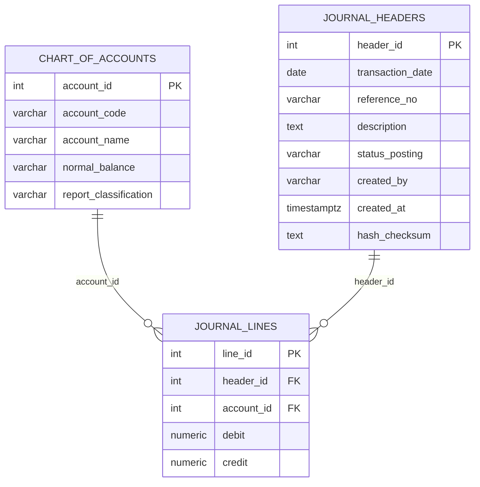
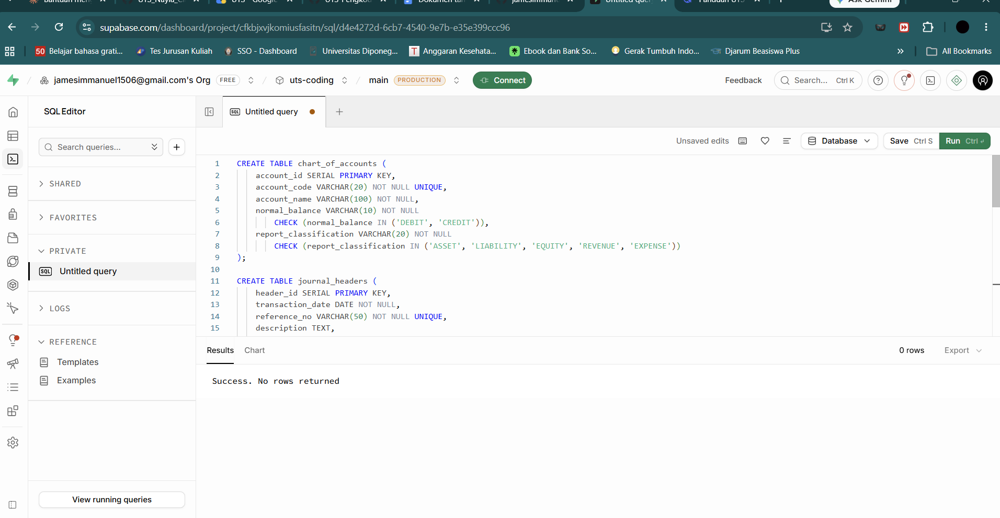
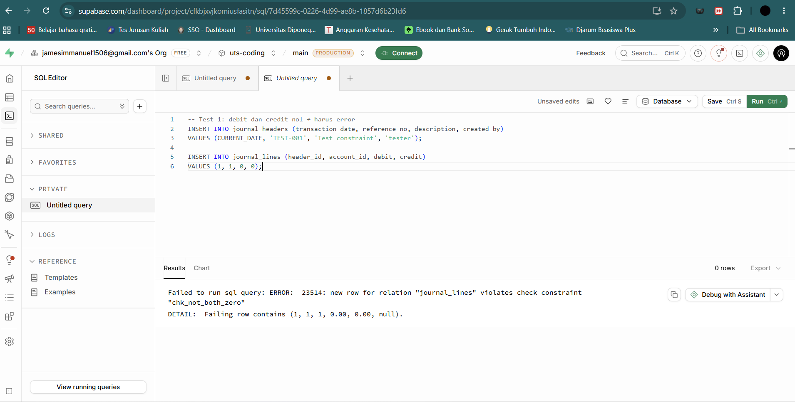
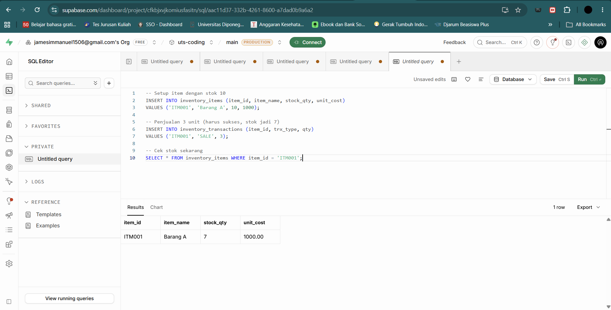
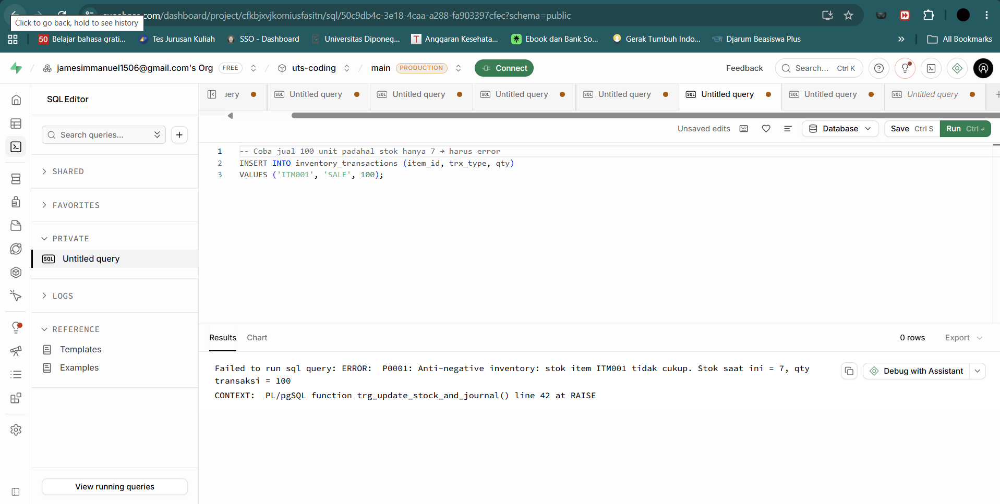
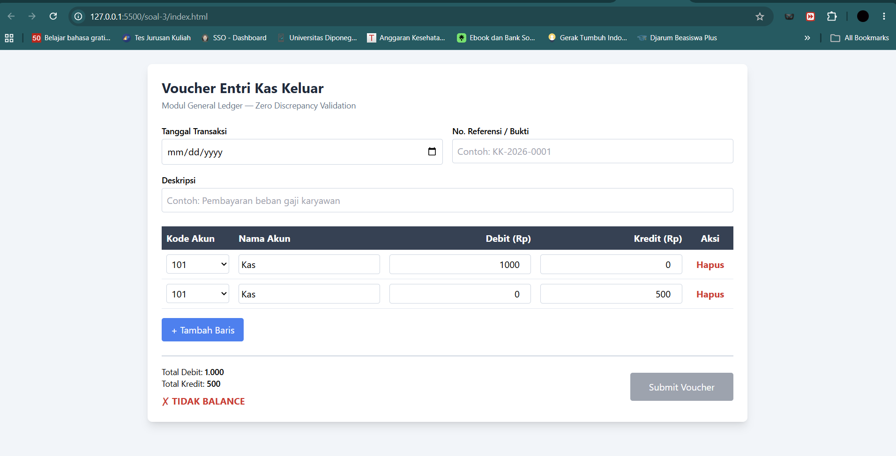
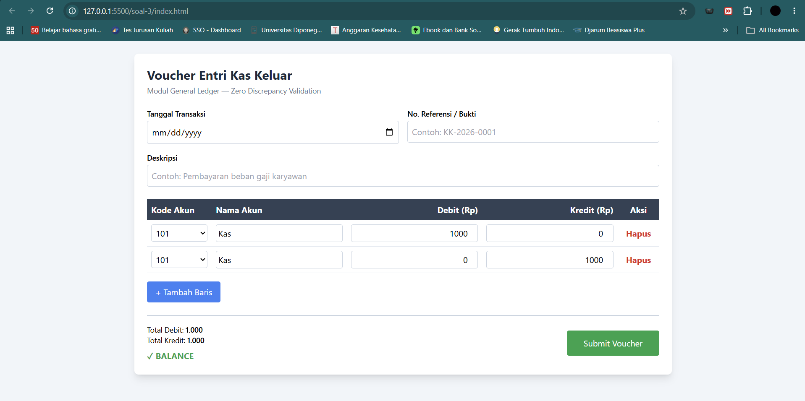
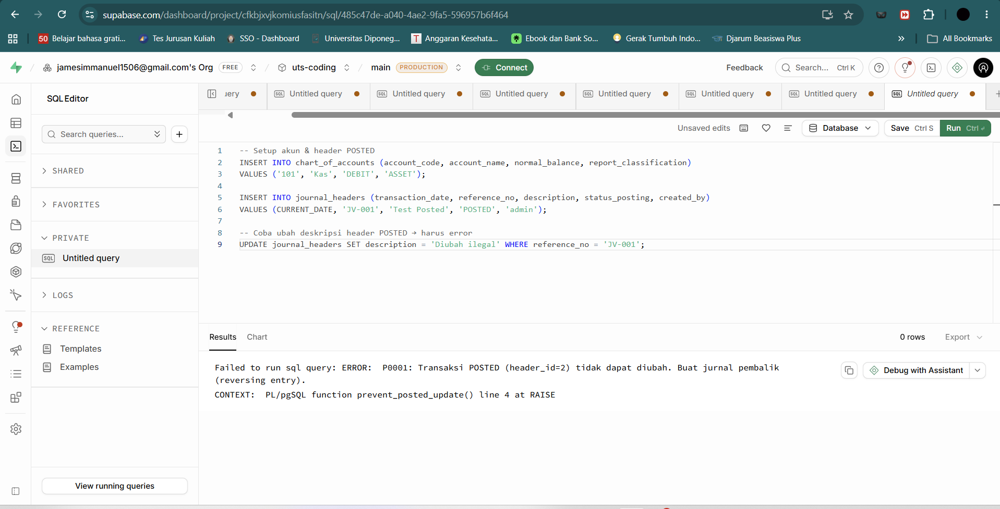

# LAPORAN UJIAN TENGAH SEMESTER
## Pemrograman / Coding Akuntansi

---

**Nama:** James Immanuel Suteja  
**NIM:** 12030124130187  
**Kelas:** S1 Akuntansi Reguler  
**Mata Kuliah:** Pemrograman dan Pengkodean Akuntansi  
**Dosen Pengampu:** Totok Dewayanto  
**Tanggal Ujian:** Selasa, 14 Oktober 2026  
**Repositori GitHub:** https:/jamesimmanuel1506/github.com//uts-coding-akuntansi  

---

## DAFTAR ISI

1. [Soal 1 — Desain Arsitektur Data, Normalisasi & Double-Entry](#soal-1)
2. [Soal 2 — Otomasi Trigger Persediaan & Concurrency](#soal-2)
3. [Soal 3 — Web Full-Stack, AI Tools & Audit Trail](#soal-3)
4. [Lampiran](#lampiran)

---

<a name="soal-1"></a>
## SOAL 1 — DESAIN ARSITEKTUR DATA, NORMALISASI & PENEGAKAN ASAS BERPASANGAN

### 1.1 Perancangan Skema Relasional (ERD)

Skema terdiri dari tiga tabel utama dengan relasi sebagai berikut:



**Relasi:**
- `chart_of_accounts` (1) — (N) `journal_lines` → satu akun dapat muncul di banyak baris jurnal
- `journal_headers` (1) — (N) `journal_lines` → satu header jurnal memiliki banyak baris detail

### 1.2 Kekangan Integritas (DDL PostgreSQL)

```sql
CREATE TABLE chart_of_accounts (
    account_id SERIAL PRIMARY KEY,
    account_code VARCHAR(20) NOT NULL UNIQUE,
    account_name VARCHAR(100) NOT NULL,
    normal_balance VARCHAR(10) NOT NULL
        CHECK (normal_balance IN ('DEBIT', 'CREDIT')),
    report_classification VARCHAR(20) NOT NULL
        CHECK (report_classification IN ('ASSET','LIABILITY','EQUITY','REVENUE','EXPENSE'))
);

CREATE TABLE journal_headers (
    header_id SERIAL PRIMARY KEY,
    transaction_date DATE NOT NULL,
    reference_no VARCHAR(50) NOT NULL UNIQUE,
    description TEXT,
    status_posting VARCHAR(10) NOT NULL DEFAULT 'DRAFT'
        CHECK (status_posting IN ('DRAFT','POSTED','REVERSED')),
    created_by VARCHAR(50) NOT NULL,
    created_at TIMESTAMPTZ NOT NULL DEFAULT CURRENT_TIMESTAMP,
    hash_checksum TEXT
);

CREATE TABLE journal_lines (
    line_id SERIAL PRIMARY KEY,
    header_id INT NOT NULL,
    account_id INT NOT NULL,
    debit  NUMERIC(15,2) NOT NULL DEFAULT 0,
    credit NUMERIC(15,2) NOT NULL DEFAULT 0,
    description TEXT,
    CONSTRAINT fk_journal_lines_header
        FOREIGN KEY (header_id) REFERENCES journal_headers(header_id)
        ON DELETE RESTRICT,
    CONSTRAINT fk_journal_lines_account
        FOREIGN KEY (account_id) REFERENCES chart_of_accounts(account_id)
        ON DELETE RESTRICT,
    CONSTRAINT chk_debit_nonnegative  CHECK (debit  >= 0),
    CONSTRAINT chk_credit_nonnegative CHECK (credit >= 0),
    CONSTRAINT chk_not_both_zero CHECK (debit > 0 OR credit > 0)
);
```

**Penjelasan constraint:**
- `PRIMARY KEY` pada ketiga tabel menjamin keunikan baris
- `FOREIGN KEY ... ON DELETE RESTRICT` mencegah penghapusan akun/header yang masih direferensikan
- `CHECK (debit >= 0)` dan `CHECK (credit >= 0)` mencegah nilai negatif
- `CHECK (debit > 0 OR credit > 0)` mencegah baris jurnal yang nol di kedua sisi
- `UNIQUE` pada `reference_no` mencegah duplikasi nomor bukti
**Bukti uji coba DDL di PostgreSQL:**





### 1.3 Analisis Audit & Keamanan Finansial

**Mengapa header-line lebih andal dari flat journal table?**

1. **Jejak audit terstruktur** — metadata transaksi (tanggal, no bukti, status, pembuat) hanya disimpan sekali di header, sedangkan detail debit/kredit ada di line. Auditor dapat melacak transaksi dengan jelas.

2. **Memenuhi 3NF** — flat table akan menduplikasi data header di setiap baris → melanggar 2NF dan 3NF. Header-line memisahkan entitas sehingga setiap atribut hanya disimpan sekali.

3. **Double-entry constraint lebih mudah ditegakkan** — dengan `header_id`, pengecekan `SUM(debit) = SUM(credit)` dapat dilakukan per jurnal.

4. **Mendukung reversing entry** — jurnal POSTED dikunci, koreksi lewat header baru (pembalik). Original tetap utuh.

5. **Keamanan finansial** — mencegah anomali update/insert/delete yang dapat menyebabkan laporan tidak balance.

---

<a name="soal-2"></a>
## SOAL 2 — OTOMASI BISNIS, STORED PROCEDURES & DATABASE TRIGGER PERSEDIAAN

### 2.1 Otomatisasi Mutasi via Database Trigger

```sql
ALTER TABLE inventory_items
ADD CONSTRAINT chk_stock_qty_nonnegative CHECK (stock_qty >= 0);

CREATE OR REPLACE FUNCTION trg_update_stock_and_journal()
RETURNS TRIGGER AS $$
DECLARE
    v_current_stock INT;
    v_new_stock INT;
BEGIN
    IF NEW.qty IS NULL OR NEW.qty = 0 THEN
        RAISE EXCEPTION 'Qty tidak boleh nol';
    END IF;

    SELECT stock_qty INTO v_current_stock
    FROM inventory_items
    WHERE item_id = NEW.item_id
    FOR UPDATE;

    IF NOT FOUND THEN
        RAISE EXCEPTION 'Item % tidak ditemukan', NEW.item_id;
    END IF;

    IF NEW.trx_type = 'PURCHASE' THEN
        v_new_stock := v_current_stock + NEW.qty;
    ELSIF NEW.trx_type = 'SALE' THEN
        IF NEW.qty <= 0 THEN
            RAISE EXCEPTION 'Qty SALE harus positif';
        END IF;
        v_new_stock := v_current_stock - NEW.qty;
    ELSIF NEW.trx_type = 'ADJUSTMENT' THEN
        v_new_stock := v_current_stock + NEW.qty;
    ELSE
        RAISE EXCEPTION 'Tipe transaksi % tidak dikenal', NEW.trx_type;
    END IF;

    IF v_new_stock < 0 THEN
        RAISE EXCEPTION
            'Anti-negative inventory: stok item % tidak cukup. Stok saat ini = %, qty = %',
            NEW.item_id, v_current_stock, NEW.qty;
    END IF;

    UPDATE inventory_items
    SET stock_qty = v_new_stock
    WHERE item_id = NEW.item_id;

    RETURN NEW;
END;
$$ LANGUAGE plpgsql;

CREATE TRIGGER trg_update_stock_and_journal
BEFORE INSERT ON inventory_transactions
FOR EACH ROW
EXECUTE FUNCTION trg_update_stock_and_journal();
```

**Hasil uji coba:**

- Insert `PURCHASE` qty 10 → stok bertambah 10
- Insert `SALE` qty 3 → stok berkurang 3
- Insert `SALE` qty > stok → ditolak dengan error anti-negative inventory





### 2.2 Penanganan Concurrency (Race Condition)

**Skenario:** Dua kasir menjual item yang sama saat stok = 1.

**Solusi utama: `SELECT ... FOR UPDATE`**

```sql
BEGIN;

SELECT stock_qty
FROM inventory_items
WHERE item_id = 'ITM001'
FOR UPDATE;         -- baris dikunci, kasir lain menunggu

UPDATE inventory_items
SET stock_qty = stock_qty - 1
WHERE item_id = 'ITM001'
  AND stock_qty >= 1;

INSERT INTO inventory_transactions (item_id, trx_type, qty)
VALUES ('ITM001', 'SALE', 1);

COMMIT;
```

**Solusi pelengkap:**
- **Isolasi `SERIALIZABLE`** → PostgreSQL mendeteksi konflik, transaksi kedua gagal → aplikasi retry
- **Constraint `CHECK (stock_qty >= 0)`** → jaring pengaman terakhir
- **Atomic update** dengan kondisi `WHERE stock_qty >= qty` → cek row count untuk deteksi gagal

Kombinasi ketiganya mencegah **overselling / phantom stock**.

---

<a name="soal-3"></a>
## SOAL 3 — INTEGRASI PURWARUPA WEB FULL-STACK & ORKESTRASI AI TOOLS

### 3.1a Gemini Canvas — Form Voucher Entri Jurnal

**Prompt yang digunakan:**

> Buatkan formulir entri jurnal kas keluar menggunakan HTML + Tailwind CSS + vanilla JavaScript. Form memiliki field tanggal, no referensi, deskripsi, dan tabel baris jurnal dinamis. Setiap baris berisi pilihan akun (kode - nama), input debit, input credit. Hitung total debit dan total credit secara real-time. Tampilkan indikator "BALANCE" hijau jika total debit = total credit dan > 0, else merah. Tombol submit disabled sampai balance. Sertakan tombol tambah/hapus baris.

**Hasil:** lihat `soal-3/index.html` — form dengan live balanced indicator dan tombol submit otomatis aktif/non-aktif.
**Tampilan form (kondisi belum balance):**



**Tampilan form (kondisi balance):**



### 3.1b NotebookLM — Verifikasi Kepatuhan PSAK

**Ringkasan verifikasi aturan bisnis:**

1. **Kas dan setara kas** (PSAK 2 / IAS 7) — mencakup kas, bank, dan investasi sangat likuid dengan jatuh tempo ≤ 3 bulan dan risiko perubahan nilai tidak signifikan.
2. **Voucher kas keluar** harus memiliki otorisasi, nomor bukti, akun lawan yang tepat, serta cut-off periode.
3. **Total debit harus sama dengan total kredit** untuk setiap transaksi.
4. **Transaksi POSTED tidak boleh diubah** — koreksi melalui jurnal pembalik (reversing entry).
5. **Audit trail minimal** — `created_by`, `created_at`, hash/checksum untuk verifikasi integritas.

### 3.2 Mekanisme Jejak Audit (Audit Trail & Immutability)

```sql
CREATE OR REPLACE FUNCTION prevent_posted_update()
RETURNS TRIGGER AS $$
BEGIN
    IF OLD.status_posting = 'POSTED' THEN
        RAISE EXCEPTION
            'Transaksi POSTED (header_id=%) tidak dapat diubah. Buat reversing entry.',
            OLD.header_id;
    END IF;
    RETURN NEW;
END;
$$ LANGUAGE plpgsql;

CREATE TRIGGER trg_prevent_posted_update
BEFORE UPDATE ON journal_headers
FOR EACH ROW
EXECUTE FUNCTION prevent_posted_update();

CREATE OR REPLACE FUNCTION prevent_posted_delete()
RETURNS TRIGGER AS $$
BEGIN
    IF OLD.status_posting = 'POSTED' THEN
        RAISE EXCEPTION
            'Transaksi POSTED tidak dapat dihapus. Buat reversing entry.';
    END IF;
    RETURN OLD;
END;
$$ LANGUAGE plpgsql;

CREATE TRIGGER trg_prevent_posted_delete
BEFORE DELETE ON journal_headers
FOR EACH ROW
EXECUTE FUNCTION prevent_posted_delete();
```

**Reversing entry:**

```sql
CREATE OR REPLACE FUNCTION create_reversing_entry(
    p_original_header_id INT,
    p_created_by VARCHAR
)
RETURNS INT AS $$
DECLARE
    v_new_header_id INT;
BEGIN
    INSERT INTO journal_headers (
        transaction_date, reference_no, description, status_posting, created_by
    )
    VALUES (
        CURRENT_DATE,
        'REV-' || p_original_header_id || '-' || to_char(now(), 'YYYYMMDDHH24MISS'),
        'Reversing entry untuk header #' || p_original_header_id,
        'POSTED',
        p_created_by
    )
    RETURNING header_id INTO v_new_header_id;

    INSERT INTO journal_lines (header_id, account_id, debit, credit, description)
    SELECT v_new_header_id, account_id, credit, debit,
           'Reversing line untuk line #' || line_id
    FROM journal_lines
    WHERE header_id = p_original_header_id;

    UPDATE journal_headers
    SET status_posting = 'REVERSED'
    WHERE header_id = p_original_header_id;

    RETURN v_new_header_id;
END;
$$ LANGUAGE plpgsql;
```

**Penjelasan field audit:**
- **`created_by`** — identitas user pembuat jurnal
- **`created_at`** — timestamp otomatis saat insert
- **`hash_checksum`** — nilai hash SHA-256 dari payload header + line, untuk mendeteksi perubahan data
- **Immutability** — trigger mencegah UPDATE/DELETE pada jurnal POSTED; koreksi hanya via reversing entry
- **Reversing entry** — header baru dengan debit/kredit ditukar; original ditandai `REVERSED`
**Bukti uji immutability:**



---

<a name="lampiran"></a>
## LAMPIRAN

### Struktur Repositori

```
uts-coding-akuntansi/
├── soal-1/
│   ├── ddl.sql
│   └── analisis.md
├── soal-2/
│   ├── trigger_stock.sql
│   └── concurrency.md
├── soal-3/
│   ├── index.html
│   └── audit-trail.sql
├── screenshots/
├── LAPORAN_UTS.md
└── README.md
```

### Link

- Repositori GitHub: https://github.com/jamesimmanuel1506/uts-coding-akuntansi
- Laporan PDF: LAPORAN_UTS.pdf (file di folder yang sama)

### Screenshot Uji Coba

| No | File | Keterangan |
|----|------|------------|
| 1 | `soal-1-ddl-success.png` | DDL berhasil dijalankan |
| 2 | `soal-1-constraint-error.png` | Constraint double-entry menolak baris nol |
| 3 | `soal-2-stok-berkurang.png` | Stok berkurang setelah penjualan |
| 4 | `soal-2-anti-negative.png` | Error anti-negative inventory |
| 5 | `soal-3-immutability.png` | Jurnal POSTED tidak bisa diubah |
| 6 | `soal-3-frontend-unbalanced.png` | Form saat belum balance |
| 7 | `soal-3-frontend-balanced.png` | Form saat balance |

---

*Laporan ini disusun untuk memenuhi Ujian Tengah Semester Gasal 2026/2027, Departemen Akuntansi, Fakultas Ekonomika dan Bisnis, Universitas Diponegoro.*